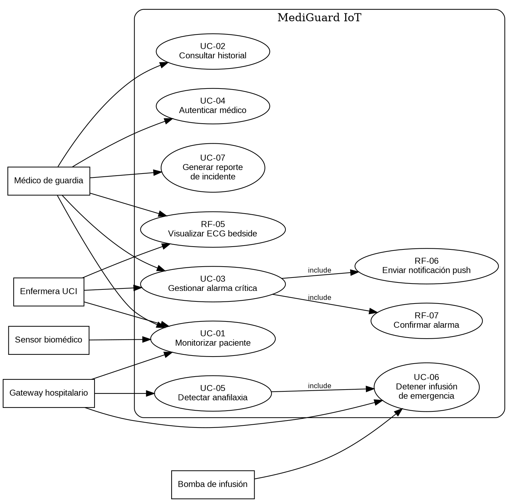
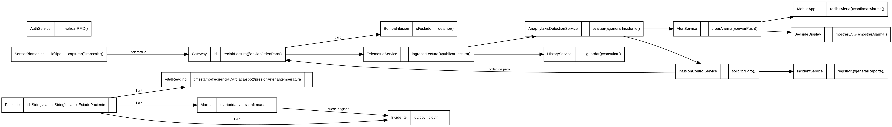
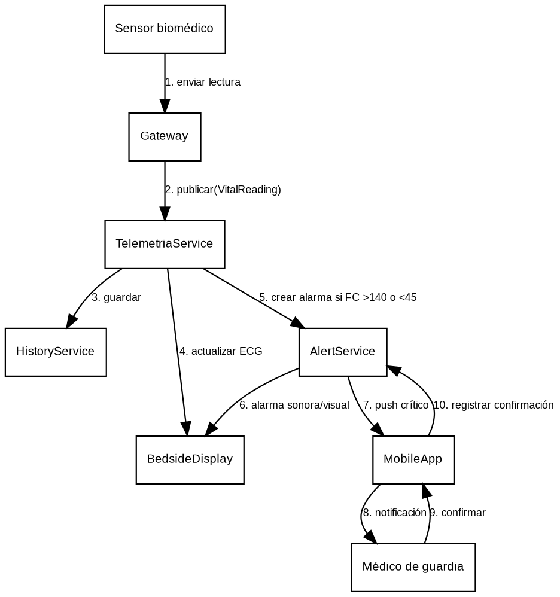
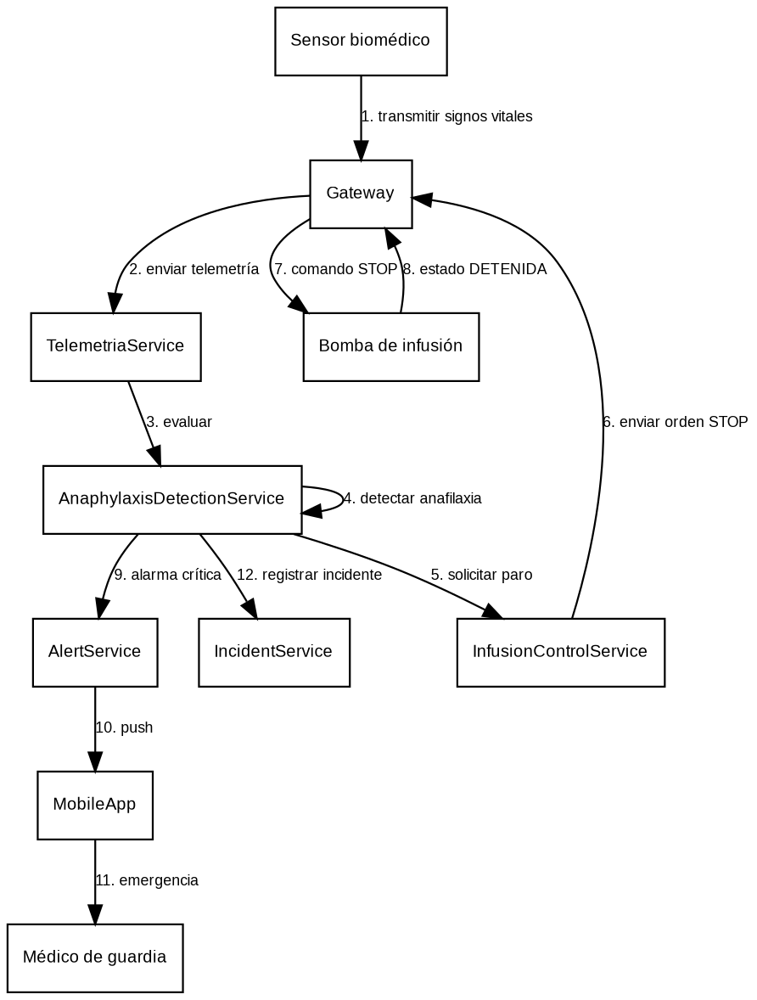
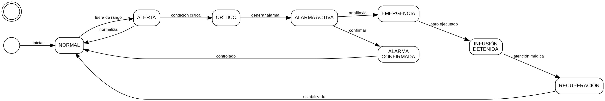

# Ingeniería de Requisitos — MediGuard IoT

> **Proyecto académico:** Especificación de Requisitos de Software para la plataforma de monitoreo crítico **MediGuard IoT**.
>
> **Repositorio sugerido en GitHub:** `Ingenieria_requisitos`

## 1. Descripción del proyecto

MediGuard IoT es una solución de monitoreo para unidades de cuidados intensivos (UCI) que integra sensores biomédicos inalámbricos, un gateway hospitalario, una plataforma central en la nube basada en microservicios, una aplicación móvil para médicos de guardia y una pantalla táctil bedside.

Este repositorio contiene la especificación de requisitos, la priorización MoSCoW, la matriz de trazabilidad y los modelos UML/PlantUML solicitados para el proyecto académico.

## 2. Estructura del repositorio

```text
Ingenieria_requisitos/
├── README.md                         # SRS principal del proyecto
├── 01_SRS/
│   └── SRS_MediGuard_IoT.md          # Copia del SRS completo
├── 02_PlantUML/
│   ├── 01_casos_uso_general.puml
│   ├── 02_clases_completo.puml
│   ├── 03_secuencia_01_telemetria_alarma.puml
│   ├── 04_secuencia_02_anafilaxia_paro.puml
│   └── 05_estados_monitorizacion.puml
├── 03_Exportaciones/
│   ├── *.png
│   └── *.svg
└── 04_Revision_IA/
    └── Revision_IA_MediGuard.md
```

## 3. Revisión rápida de los modelos

### 3.1 Diagrama general de casos de uso



[Ver fuente PlantUML](02_PlantUML/01_casos_uso_general.puml) · [Ver SVG](03_Exportaciones/01_casos_uso_general.svg)

### 3.2 Diagrama de clases completo



[Ver fuente PlantUML](02_PlantUML/02_clases_completo.puml) · [Ver SVG](03_Exportaciones/02_clases_completo.svg)

### 3.3 Diagrama de secuencia 1 — Telemetría y alarma crítica



[Ver fuente PlantUML](02_PlantUML/03_secuencia_01_telemetria_alarma.puml) · [Ver SVG](03_Exportaciones/03_secuencia_01_telemetria_alarma.svg)

### 3.4 Diagrama de secuencia 2 — Anafilaxia y paro de infusión



[Ver fuente PlantUML](02_PlantUML/04_secuencia_02_anafilaxia_paro.puml) · [Ver SVG](03_Exportaciones/04_secuencia_02_anafilaxia_paro.svg)

### 3.5 Diagrama de estados — Monitorización del paciente



[Ver fuente PlantUML](02_PlantUML/05_estados_monitorizacion.puml) · [Ver SVG](03_Exportaciones/05_estados_monitorizacion.svg)

---

**Estándares de referencia indicados por la guía:** IEEE 830 / ISO/IEC/IEEE 29148.

> **Nota de alcance:** La guía aporta el caso de estudio, requisitos de ejemplo y criterios de verificación. Los requisitos que no aparecen literalmente en la guía se presentan como **propuestas derivadas** para completar el SRS solicitado en la sección 5.1. Se mantienen los términos del caso: sensores biomédicos inalámbricos, gateway hospitalario, plataforma central en la nube basada en microservicios, aplicación móvil y pantalla bedside.

---

## 1. Propósito y alcance

MediGuard IoT monitorea en tiempo real frecuencia cardíaca, SpO2, presión arterial y temperatura de pacientes en UCI. La solución integra sensores biomédicos inalámbricos, gateway hospitalario, backend en la nube, aplicación móvil para médicos de guardia y pantalla táctil bedside.

El SRS formaliza las funcionalidades y atributos de calidad necesarios para capturar telemetría, detectar eventos críticos, alertar al personal médico, conservar historial clínico y soportar la respuesta de emergencia.

## 2. Actores principales

| ID | Actor | Responsabilidad |
|---|---|---|
| A-01 | Médico de guardia | Autenticarse, supervisar pacientes, recibir y confirmar alarmas, consultar historial. |
| A-02 | Enfermera UCI | Supervisar paciente en bedside, visualizar señales y alarmas. |
| A-03 | Sensor biomédico | Capturar signos vitales y transmitir lecturas. |
| A-04 | Gateway hospitalario | Recibir telemetría, validar/enrutar datos y ejecutar órdenes de control autorizadas. |
| A-05 | Bomba de infusión | Ejecutar o detener la infusión según una orden de paro válida. |

## 3. Requisitos Funcionales (RF) - priorización MoSCoW

### 3.1 Tabla de requisitos

| ID | MoSCoW | Requisito formal | Criterio de aceptación / verificación |
|---|---|---|---|
| RF-01 | MUST | El sistema debe emitir una alarma sonora y visual de prioridad alta cuando el ritmo cardíaco de un paciente supere 140 BPM o descienda de 45 BPM. | Simulación de valores 141 BPM y 44 BPM; debe generarse alarma en ambos casos. |
| RF-02 | MUST | El sistema debe recibir y transmitir las lecturas de frecuencia cardíaca, SpO2, presión arterial y temperatura desde los sensores hacia el gateway y la plataforma central, conservando paciente y marca de tiempo. | Prueba de integración con cuatro tipos de lectura y validación de trazabilidad de cada muestra. |
| RF-03 | SHOULD | El sistema debe almacenar el historial de signos vitales de cada paciente y permitir su consulta por rango de fecha y tipo de signo vital. | Registrar datos de prueba y comprobar consultas por paciente, signo y periodo. |
| RF-04 | MUST | El sistema debe autenticar a los médicos mediante tarjeta RFID antes de permitir el acceso a funciones clínicas protegidas. | Pruebas con RFID autorizado y no autorizado; solo el autorizado obtiene sesión clínica. |
| RF-05 | MUST | El sistema debe mostrar en la pantalla bedside la curva ECG del paciente con un refresco mínimo de 60 FPS. | Medición de frecuencia de actualización durante una sesión de monitorización. |
| RF-06 | MUST | El sistema debe enviar una notificación push al móvil del médico cuando se genere un evento crítico asociado a un paciente. | Inyección de evento crítico y comprobación de recepción por un dispositivo autorizado. |
| RF-07 | MUST | El sistema debe registrar la confirmación de lectura de una alarma crítica, incluyendo usuario, paciente, fecha y hora. | Confirmar una alarma y verificar persistencia de usuario, paciente y timestamp. |
| RF-08 | MUST | El sistema debe analizar los signos vitales del paciente y generar un evento de anafilaxia inminente cuando el algoritmo de detección supere el umbral clínico configurado. | Ejecutar escenarios de prueba definidos por el algoritmo y verificar clasificación del evento. |
| RF-09 | MUST | Ante un evento de anafilaxia confirmado, el sistema debe enviar una orden de paro al gateway para detener la infusión de la bomba intravenosa conectada. | Simulación controlada de evento y verificación de envío, recepción y ejecución de la orden. |
| RF-10 | COULD | El sistema debe generar un reporte de incidente que consolide signos vitales, alarmas, confirmaciones y acciones de emergencia asociadas a un paciente. | Crear un incidente de prueba y comprobar que el reporte contiene todos los eventos relacionados. |

### 3.2 Justificación MoSCoW

- **MUST:** funciones críticas para monitorización, seguridad del paciente, autenticación y respuesta a eventos clínicos.
- **SHOULD:** función importante para operación clínica, pero no bloquea el núcleo de monitorización y respuesta inmediata.
- **COULD:** mejora de análisis y documentación clínica que puede diferirse sin impedir la operación crítica.
- **WON'T (en esta entrega):** no se fija ninguna funcionalidad como excluida de forma permanente; la guía no proporciona una lista de exclusiones explícitas.

## 4. Requisitos No Funcionales (RNF)

| ID | Categoría | Requisito formal | Métrica / método de verificación |
|---|---|---|---|
| RNF-01 | Desempeño | El sistema debe transmitir y proyectar la señal de telemetría con una latencia total de extremo a extremo menor a 500 ms. | Latencia E2E medida con generador de eventos y monitoreo de timestamps. |
| RNF-02 | Seguridad | El sistema debe cifrar el expediente clínico almacenado en reposo utilizando AES-256. | Inspección de configuración y prueba de almacenamiento; no deben existir registros clínicos en claro. |
| RNF-03 | Disponibilidad | El sistema debe mantener una disponibilidad mensual mínima de 99.99% para los servicios centrales de monitorización. | Cálculo mensual de uptime a partir de logs/monitorización. |
| RNF-04 | Usabilidad | La aplicación clínica debe obtener un puntaje mínimo de 80/100 en la escala SUS durante una prueba con usuarios representativos de UCI. | SUS aplicado a un mínimo de 10 usuarios. |
| RNF-05 | Confiabilidad / comunicación | La plataforma debe mantener una pérdida de paquetes de telemetría menor o igual a 0.1% durante condiciones normales de operación. | Prueba de carga y monitorización de paquetes en un periodo controlado. |

## 5. Reglas y restricciones derivadas del caso

1. Los datos clínicos son sensibles y deben tratarse como información protegida.
2. Las alarmas deben ser verificables mediante umbrales, tiempos y registros de eventos.
3. La seguridad del paciente es una propiedad emergente: depende de la interacción entre sensores, red, gateway, microservicios, interfaces y dispositivos conectados.
4. La solución debe contemplar la descomposición sistema -> hardware -> software -> interfaces indicada por la actividad.

## 6. Matriz de trazabilidad

| Fuente / necesidad | Requisito | Caso de uso asociado | Modelo(s) | Verificación |
|---|---|---|---|---|
| N-01 Monitorizar signos vitales en UCI | RF-02 | UC-01 Monitorizar paciente | UC, CL, SD-01 | Prueba de integración |
| N-02 Alertar por frecuencia cardíaca crítica | RF-01 | UC-03 Gestionar alarma crítica | UC, SD-01, ST | Prueba funcional con valores límite |
| N-03 Consultar historial clínico | RF-03 | UC-02 Consultar historial | UC, CL | Prueba funcional |
| N-04 Autenticación médica con RFID | RF-04 | UC-04 Autenticar médico | UC, CL | Prueba de autenticación |
| N-05 Visualización bedside en tiempo real | RF-05 | UC-01 Monitorizar paciente | UC, SD-01 | Medición de FPS |
| N-06 Notificación móvil de emergencia | RF-06 | UC-03 Gestionar alarma crítica | UC, SD-01 | Prueba push |
| N-07 Confirmación y auditoría de alarma | RF-07 | UC-03 Gestionar alarma crítica | UC, CL, SD-01 | Inspección de registros |
| N-08 Detección de anafilaxia | RF-08 | UC-05 Detectar anafilaxia | UC, CL, SD-02, ST | Prueba de escenarios |
| RS-01 Detener infusión automáticamente | RF-09 | UC-06 Detener infusión de emergencia | UC, CL, SD-02, ST | Prueba de integración controlada |
| N-09 Documentar incidente clínico | RF-10 | UC-07 Generar reporte de incidente | UC, CL | Prueba funcional |
| N-10 Latencia en tiempo real | RNF-01 | UC-01 Monitorizar paciente | SD-01 | Prueba de desempeño |
| N-11 Protección de expediente clínico | RNF-02 | UC-04 Autenticar médico | CL | Inspección de seguridad |
| N-12 Continuidad operacional | RNF-03 | UC-01 Monitorizar paciente | UC, SD-01 | Prueba de disponibilidad |
| N-13 Facilidad de uso clínico | RNF-04 | UC-01, UC-03, UC-04 | UC, SD-01 | Test SUS |
| N-14 Integridad de telemetría | RNF-05 | UC-01 Monitorizar paciente | SD-01 | Prueba de carga / pérdida |

## 7. Casos de uso resumidos

| ID | Caso de uso | Actor(es) | Resultado principal |
|---|---|---|---|
| UC-01 | Monitorizar paciente | Médico, Enfermera, Sensor, Gateway | Telemetría visible y persistida. |
| UC-02 | Consultar historial | Médico | Historial de signos vitales disponible por filtros. |
| UC-03 | Gestionar alarma crítica | Médico, Enfermera | Alarma emitida y confirmación registrada. |
| UC-04 | Autenticar médico | Médico | Acceso clínico concedido o rechazado. |
| UC-05 | Detectar anafilaxia | Gateway, Servicio de detección | Incidente de emergencia generado. |
| UC-06 | Detener infusión de emergencia | Servicio de control, Gateway, Bomba | Infusión detenida y evento auditado. |
| UC-07 | Generar reporte de incidente | Médico | Reporte consolidado generado. |

## 8. Correspondencia con los modelos

- **Diagrama General de Casos de Uso:** actores, objetivos y límites funcionales del sistema.
- **Diagrama de Clases Completo:** entidades clínicas, componentes de software y relaciones principales.
- **Secuencia 01:** flujo de telemetría y alarma crítica.
- **Secuencia 02:** detección de anafilaxia y paro de infusión.
- **Diagrama de Estados:** ciclo de estado de monitorización/alarmas del paciente.

## 9. Criterio de completitud de esta entrega

La entrega cubre los cuatro grupos solicitados en la sección 5.1: SRS con 10 RF y 5 RNF, priorización MoSCoW, matriz de trazabilidad, cinco fuentes PlantUML y exportaciones gráficas correspondientes.

## 10. Revisión por IA

La especificación fue sometida a una revisión de ingeniería de requisitos enfocada en su utilidad para un desarrollador. El dictamen detallado se encuentra en [`04_Revision_IA/Revision_IA_MediGuard.md`](04_Revision_IA/Revision_IA_MediGuard.md).
